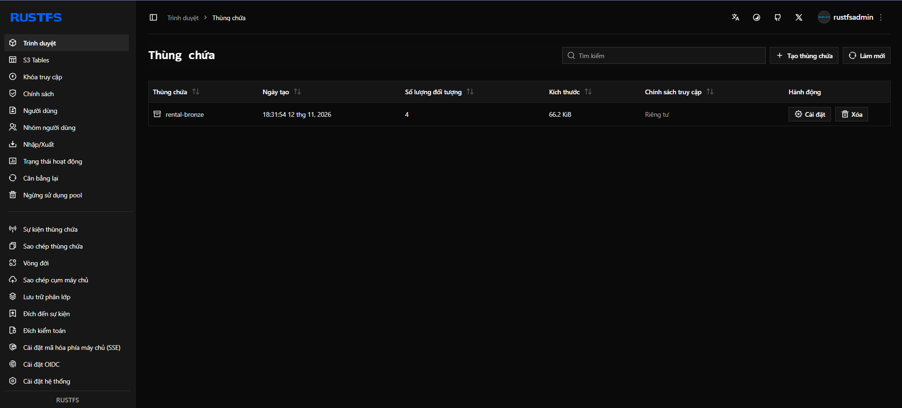

# RentalPulse

Data pipeline theo dõi tin đăng thuê nhà ở Việt Nam: thu thập, lưu trữ, làm sạch, theo dõi biến động giá và vòng đời tin đăng. Dự án học tập chạy hoàn toàn trên máy cá nhân (Docker), không triển khai lên cloud.

## Mục tiêu

- Theo dõi lịch sử giá của cùng một tin đăng, không ghi đè dữ liệu cũ.
- Phát hiện vòng đời tin: tin mới, đổi giá, biến mất, xuất hiện lại.
- Ghép các tin đăng cùng một căn phòng (đăng lại trong một nguồn, giữa các nguồn).
- Kiểm tra chất lượng dữ liệu và theo dõi trạng thái pipeline.

## Kiến trúc

```
Nguồn (Nhà Tốt, Batdongsan, mock)
        |
   Python Collector
        |
 Bronze (RustFS, JSON, chỉ ghi thêm)
        |
 Kafka: listing.events  --(lỗi)--> listing.events.dlq
        |
 PostgreSQL: raw.listings (JSONB nguyên văn)
        |
 staging.listings (ép kiểu, chuẩn hóa, loại trùng)
        |
 core.listing_source + core.fact_listing_snapshot
        |
 Views: lịch sử giá, vòng đời tin, tin đăng lại
        |
 Kafka: listing.price_changes   ...   Airflow + dbt   ...   Power BI
```

Nguyên tắc: Bronze và Raw là nguồn sự thật, Staging và Core là tầng dẫn xuất và dựng lại được (`--rebuild`). Mọi bước nạp đều idempotent: chạy lại không tạo dòng trùng.

## Trạng thái

| Giai đoạn | Nội dung | Trạng thái |
|---|---|---|
| 0 | Chuẩn hóa môi trường | Gần xong |
| 1 | Thu thập dữ liệu và tầng Bronze | Gần xong |
| 2 | PostgreSQL và mô hình dữ liệu | Xong |
| 3 | Batch ETL | Xong |
| 4 | Lịch sử giá, vòng đời, ghép tin | Đang làm (còn ghép giữa các nguồn) |
| 5 | Kafka | Phần lớn xong |
| 6 | Airflow, dbt, data quality | Chưa bắt đầu |
| 7 | Dashboard và portfolio | Chưa bắt đầu |

Lộ trình chi tiết nằm trong Project của dự án.

## Nguồn dữ liệu

| Nguồn | Loại | Cách lấy |
|---|---|---|
| Nhà Tốt | Thật, công khai | Lưu tay HTML trang 1, đọc `__NEXT_DATA__` |
| Batdongsan | Thật, công khai | Lưu tay HTML trang 1 (tải tự động bị 403) |
| mock | Mô phỏng, có kịch bản và đáp án biết trước | Sinh theo ngày, dùng để kiểm thử |

Quy tắc thu thập: chỉ trang 1, giãn cách giữa các request, User-Agent trung thực, dừng khi gặp 403/429/captcha, không vượt chặn. Parser chỉ đọc dữ liệu tối thiểu (không lấy hồ sơ người đăng, số điện thoại, mô tả, ảnh). Dữ liệu thô nằm ở `data/` và không đưa lên GitHub. Chi tiết trong [docs/data-sources.md](docs/data-sources.md).

Lưu ý: nguồn thật hiện chỉ có vài ngày dữ liệu, nên lịch sử giá thật còn ít. Với nguồn thật, "biến mất" nghĩa là rơi khỏi trang 1, chưa chắc tin đã bị gỡ.

## Công nghệ

| Thành phần | Vai trò |
|---|---|
| Python | Collector, ETL, Kafka producer/consumer |
| RustFS | Kho đối tượng chuẩn S3, lưu dữ liệu thô (Bronze) |
| Kafka | Truyền sự kiện (listing_observed, price_changed) |
| PostgreSQL 16 | Kho dữ liệu: Raw, Staging, Core |
| Airflow, dbt | Điều phối và biến đổi dữ liệu (Giai đoạn 6) |
| Power BI | Dashboard (Giai đoạn 7) |
| Docker Compose | Dựng toàn bộ hạ tầng |

## Yêu cầu

Docker Desktop (WSL 2, nên cấp từ 4 GB RAM), Python 3.10 và Git.

## Chạy nhanh

```powershell
copy .env.example .env
docker compose up -d postgres rustfs kafka kafka-ui
python -m venv .venv
.\.venv\Scripts\Activate.ps1
pip install -r requirements-dev.txt
python scripts\check_env.py
```

Mở `.env` và điền các giá trị còn trống trước khi chạy Docker. Kết quả mong đợi của `check_env.py` là ba dòng `OK` (Postgres, Object storage, Kafka).

Khởi tạo schema và bảng (lần đầu):

```powershell
python -m etl.run_pipeline --init
```

## Cách dùng hằng ngày

Dữ liệu mô phỏng (ngày 1, 2, 3...):

```powershell
python -m collectors.collector --day 1
```

Dữ liệu thật: lưu HTML trang 1 vào `data\inbox\` với tên `nhatot_YYYY-MM-DD.html` hoặc `batdongsan_YYYY-MM-DD.html`, rồi:

```powershell
python -m etl.ingest_inbox
```

Chạy chuỗi ETL (Bronze, Raw, Staging, Core):

```powershell
python -m etl.run_pipeline
```

Chạy luồng Kafka (Bronze, Kafka, Raw, Staging/Core, sự kiện đổi giá):

```powershell
python -m etl.run_kafka_flow --since 2026-11-21
```

Dựng lại Staging và Core từ Raw, hoặc xóa một batch thử:

```powershell
python -m etl.run_pipeline --rebuild
python -m etl.purge_batch <batch_id>          # xem trước
python -m etl.purge_batch <batch_id> --yes    # xóa thật, rồi chạy --rebuild
```

Kiểm thử:

```powershell
python -m pytest tests -q
```

Các test cần PostgreSQL tự bỏ qua khi không có database.

## Cấu trúc

| Thư mục | Vai trò |
|---|---|
| `collectors/` | Nguồn mock, parser Nhà Tốt và Batdongsan, fetcher lịch sự, collector điều phối |
| `storage/rustfs.py` | Client RustFS (boto3) |
| `etl/` | Nạp Raw, chạy pipeline, nhập thư mục inbox, xóa batch, producer/consumer Kafka |
| `sql/` | Schema, hàm chuẩn hóa, nạp Staging/Core, view lịch sử giá và vòng đời |
| `tests/` | Kiểm thử đơn vị, kịch bản mock có đáp án, tích hợp PostgreSQL |
| `scripts/check_env.py` | Kiểm tra kết nối PostgreSQL, RustFS, Kafka |
| `airflow/`, `dbt/` | Dành cho Giai đoạn 6 |
| `docs/` | Sổ nguồn dữ liệu và tài liệu |

Đường dẫn trong Bronze: `source=<nguồn>/dt=<ngày dữ liệu>/batch_id=<mã lần chạy>/listings.json`

## Mô hình dữ liệu

| Tầng | Bảng / view | Ghi chú |
|---|---|---|
| Raw | `raw.listings` | JSONB nguyên văn, UNIQUE (batch_id, record_no) |
| Staging | `staging.listings` | Giá, diện tích, quận đã chuẩn hóa; "Thỏa thuận" là NULL, không phải 0 |
| Core | `core.listing_source`, `core.fact_listing_snapshot` | Mỗi tin mỗi ngày một dòng; cờ `is_simulated` |
| View | `core.v_price_history` | Đổi giá theo thời gian (LAG) |
| View | `core.v_listing_events` | Tin mới, biến mất, quay lại |
| View | `core.v_repost_candidates` | Ứng viên tin đăng lại |

## Kafka

| Topic | Nội dung |
|---|---|
| `listing.events` | Mỗi tin quan sát được, key `source:listing_id` |
| `listing.events.dlq` | Event hỏng kèm lý do trong header `error` |
| `listing.price_changes` | Mỗi lần giá tăng hoặc giảm |

Consumer commit offset sau khi database đã commit (at-least-once), và việc chống trùng do `ON CONFLICT DO NOTHING`. Từ máy host dùng `localhost:29092`, từ container dùng `kafka:9092`. Chỉ có một broker nên replication factor là 1.

## Cấu hình `.env`

| Biến | Ý nghĩa |
|---|---|
| `POSTGRES_USER`, `POSTGRES_PASSWORD`, `POSTGRES_DB` | Tài khoản và tên database của PostgreSQL |
| `POSTGRES_HOST`, `POSTGRES_PORT` | Địa chỉ PostgreSQL khi truy cập từ máy bạn |
| `RUSTFS_ACCESS_KEY`, `RUSTFS_SECRET_KEY` | Tài khoản của RustFS |
| `RUSTFS_ENDPOINT` | Địa chỉ API của RustFS, ví dụ `localhost:9000` |
| `RUSTFS_BUCKET` | Tên bucket chứa dữ liệu thô |
| `KAFKA_BOOTSTRAP_SERVERS` | Địa chỉ Kafka cho `check_env.py` |
| `KAFKA_BOOTSTRAP` (tùy chọn) | Địa chỉ Kafka cho các script `etl/`, mặc định `localhost:29092` |

## Địa chỉ dịch vụ

| Dịch vụ | Địa chỉ |
|---|---|
| RustFS Console | http://localhost:9001/rustfs/console/ |
| RustFS S3 API | http://localhost:9000 |
| Kafka UI | http://localhost:8080 |
| Airflow (Giai đoạn 6) | http://localhost:8081 |
| PostgreSQL | `localhost:5432` |
| Kafka (từ máy host) | `localhost:29092` |

## Giao diện RustFS


