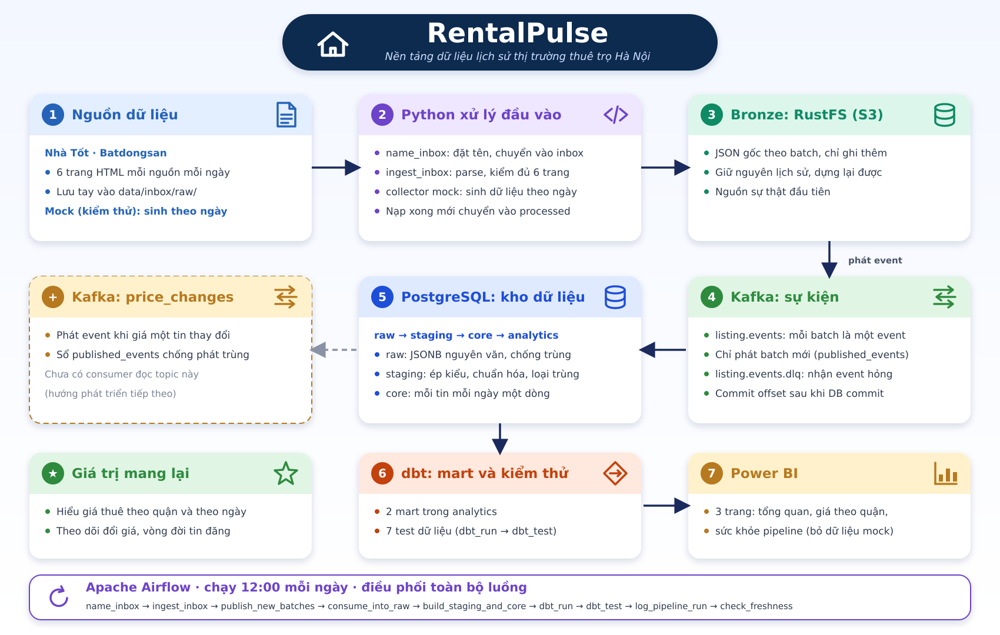
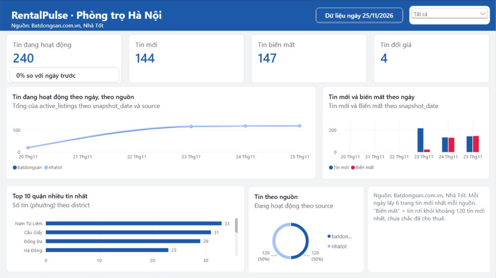
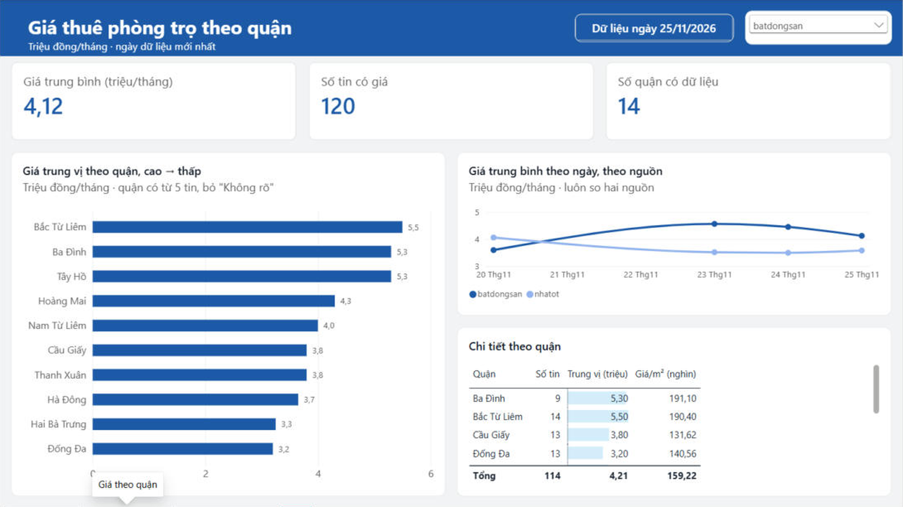
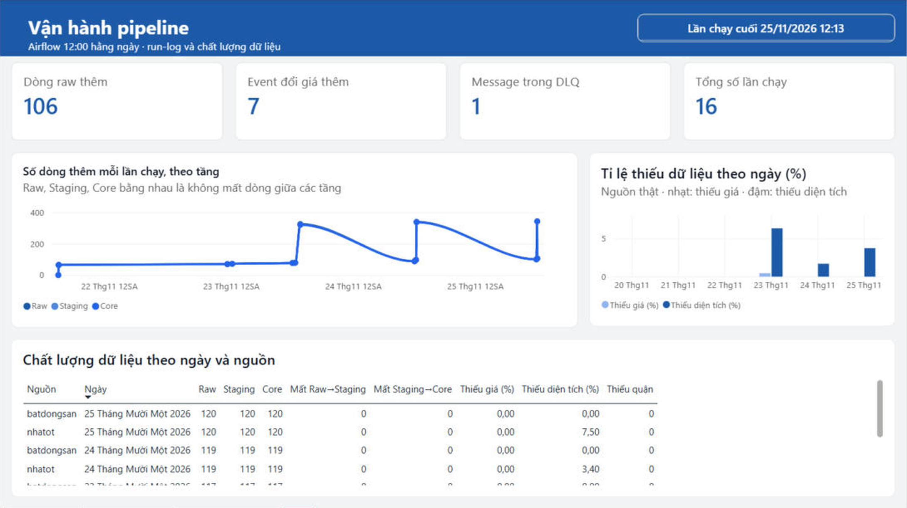

# RentalPulse

Data pipeline theo dõi tin cho thuê phòng trọ ở Hà Nội: thu thập, lưu trữ, làm sạch, theo dõi biến động giá và vòng đời tin đăng, rồi đưa lên dashboard. Toàn bộ hệ thống chạy trên máy cá nhân bằng Docker Compose.


---

## 1. Tổng quan

RentalPulse trả lời các câu hỏi:

- Mỗi ngày có bao nhiêu tin đang hoạt động, bao nhiêu tin mới, bao nhiêu tin biến mất hoặc quay lại?
- Giá thuê trung vị và giá/m² theo từng quận thay đổi ra sao theo thời gian?
- Tin nào vừa tăng hoặc giảm giá? Tin nào có vẻ là một phòng cũ được đăng lại với mã mới?
- Lần chạy pipeline gần nhất nạp được bao nhiêu dòng, có message nào rơi vào DLQ không?

**Tính năng đã làm**

- **Thu thập:** parser cho Nhà Tốt (đọc khối `__NEXT_DATA__`) và Batdongsan (tách quận, phường), cùng nguồn mock có kịch bản và đáp án biết trước.
- **Lưu trữ nhiều tầng:** Bronze (RustFS) → Raw → Staging → Core → Analytics. Mọi bước nạp đều idempotent.
- **Streaming:** Kafka cho event tin đăng, DLQ cho event hỏng, topic riêng cho event đổi giá.
- **Lịch sử và vòng đời:** lịch sử giá theo ngày, tin mới / biến mất / quay lại, ứng viên tin đăng lại.
- **Biến đổi và kiểm thử dữ liệu:** dbt dựng 2 mart và chạy 7 test dữ liệu.
- **Điều phối:** Airflow chạy toàn bộ luồng mỗi ngày lúc 12:00, có cổng kiểm tra đủ trang, run-log và kiểm tra độ mới của dữ liệu.
- **Chất lượng:** 200 test pytest (41 test tích hợp cần Docker), view theo dõi tỉ lệ thiếu dữ liệu theo ngày.

---

## 2. Công nghệ

| Thành phần | Phiên bản | Vai trò |
|---|---|---|
| Python | 3.10 | Collector, parser (BeautifulSoup), ETL, Kafka producer/consumer |
| RustFS | — | Kho đối tượng chuẩn S3 cho tầng Bronze |
| Apache Kafka | — | Event tin đăng, DLQ, event đổi giá |
| PostgreSQL | 16 | Kho dữ liệu: Raw, Staging, Core, Analytics |
| dbt | 1.12 | Mart cho dashboard và test dữ liệu |
| Apache Airflow | 2.10 | Điều phối hằng ngày (image riêng, dbt trong venv tách biệt) |
| Power BI | Desktop | Dashboard, Import từ schema `analytics` |
| Docker Compose | — | Dựng toàn bộ hạ tầng |

---

## 3. Kiến trúc



**Nguyên tắc thiết kế**

- Bronze và Raw là nguồn sự thật. Staging và Core là tầng dẫn xuất, dựng lại được từ Raw (`--rebuild`).
- Mọi bước nạp đều idempotent: chạy lại không tạo dòng trùng.
- Consumer Kafka commit offset sau khi database đã commit (at-least-once); chống trùng bằng `ON CONFLICT DO NOTHING`.
- Dữ liệu mock luôn mang cờ `is_simulated`; dashboard chỉ hiện dữ liệu thật.

---

## 4. Cấu trúc thư mục

```
RentalPulse/
├── airflow/
│   ├── Dockerfile              # image Airflow có dbt trong venv riêng
│   └── dags/
│       └── rentalpulse_kafka_flow.py
├── collectors/                 # parser Nhà Tốt, Batdongsan, nguồn mock, collector ghi Bronze
├── dbt/
│   ├── models/marts/           # mart_daily_listing_flow, mart_price_by_district_daily
│   └── tests/                  # 7 test dữ liệu
├── docs/
│   ├── RUNBOOK.md              # hướng dẫn chạy một vòng đầy đủ
│   ├── data-sources.md         # sổ nguồn dữ liệu và nhật ký kiểm tra
│   └── powerbi/                # theme và file .pbix
├── etl/                        # nạp inbox, Raw, pipeline, Kafka, event đổi giá, run-log
├── scripts/
│   ├── check_env.py            # kiểm tra kết nối Postgres, RustFS, Kafka
│   └── name_inbox.py           # tự đặt tên trang đã lưu
├── sql/                        # 13 file: schema, hàm chuẩn hóa, Staging/Core, view
├── storage/                    # client RustFS (boto3)
├── tests/                      # 200 test: đơn vị, kịch bản mock, tích hợp PostgreSQL
├── docker-compose.yml
├── requirements.txt
└── requirements-dev.txt
```

---

## 5. Cài đặt và chạy local

Cần có: **Docker Desktop** (WSL 2, nên cấp từ 4 GB RAM), **Python 3.10+**, **Git**.

### Bước 1. Clone repo

```powershell
git clone https://github.com/kienit05/RentalPulse.git
cd RentalPulse
```

### Bước 2. Tạo file `.env`

```powershell
Copy-Item .env.example .env
```

Mở `.env` và điền các giá trị còn trống:

```env
POSTGRES_USER=rental
POSTGRES_PASSWORD=<tự đặt>
POSTGRES_DB=rentalpulse
POSTGRES_HOST=localhost
POSTGRES_PORT=5432

RUSTFS_ACCESS_KEY=<tự đặt>
RUSTFS_SECRET_KEY=<tự đặt>
RUSTFS_ENDPOINT=localhost:9000
RUSTFS_BUCKET=rental-bronze

KAFKA_BOOTSTRAP_SERVERS=localhost:29092
```

> **Lưu ý:** `.env` chứa mật khẩu nên đã nằm trong `.gitignore`. Docker dùng chính các giá trị này để tạo tài khoản Postgres và RustFS.

### Bước 3. Môi trường Python

```powershell
python -m venv .venv
.\.venv\Scripts\Activate.ps1
pip install -r requirements-dev.txt
New-Item -ItemType Directory -Force data\inbox, data\processed
```

### Bước 4. Khởi động hạ tầng

```powershell
docker compose up -d --build
docker compose ps
python scripts\check_env.py
```

Mọi container ở trạng thái `running` (riêng `rental-airflow-init` chạy xong rồi thoát là đúng). `check_env.py` in ra ba dòng `OK`.

### Bước 5. Khởi tạo database

```powershell
python -m etl.run_pipeline --skip-bronze --init
```

Lệnh tạo schema, bảng, hàm, view. Chạy lại an toàn; cần chạy lại mỗi khi thêm file vào `sql/`.

> **Chạy một vòng đầy đủ, kiểm tra kết quả và xử lý sự cố:** xem [docs/RUNBOOK.md](docs/RUNBOOK.md).

### Địa chỉ dịch vụ

| Dịch vụ | Địa chỉ |
|---|---|
| Airflow | http://localhost:8081 (admin / admin) |
| Kafka UI | http://localhost:8080 |
| RustFS Console | http://localhost:9001/rustfs/console/ |
| PostgreSQL | `localhost:5432` |
| Kafka (từ máy host) | `localhost:29092` |

---

## 6. Nguồn dữ liệu và vận hành hằng ngày

| Nguồn | Loại | Cách lấy |
|---|---|---|
| Nhà Tốt | Thật, công khai | HTML trang danh sách thuê phòng trọ Hà Nội, 6 trang/ngày |
| Batdongsan | Thật, công khai | HTML trang danh sách phòng trọ Hà Nội, sắp theo tin mới nhất, 6 trang/ngày |
| Mock | Mô phỏng, có đáp án | Sinh theo ngày, dùng để kiểm thử |

Chi tiết từng nguồn trong [docs/data-sources.md](docs/data-sources.md).

**Mỗi ngày**

1. Lưu 6 trang HTML của mỗi nguồn vào `data/inbox/raw/` trước 12:00. DAG tự chạy `name_inbox` để đặt tên và chuyển vào `data/inbox/`, rồi `ingest_inbox` nạp vào Bronze. Cũng có thể chạy tay `python -m scripts.name_inbox`.
2. 12:00, DAG `rentalpulse_kafka_flow` tự chạy:

| Thứ tự | Task | Việc làm |
|---|---|---|
| 1 | `collect_mock` | Sinh một ngày dữ liệu mock |
| 1 | `ingest_inbox` | Nạp trang thật vào Bronze; nguồn nào thiếu trang thì không nạp, task báo đỏ |
| 2 | `publish_new_batches` | Bronze → Kafka, chỉ batch mới |
| 3 | `consume_into_raw` | Kafka → `raw.listings` |
| 4 | `build_staging_and_core` | Raw → Staging → Core |
| 5 | `publish_price_changes` · `dbt_run` → `dbt_test` | Phát event đổi giá; dựng và kiểm thử mart |
| 6 | `log_pipeline_run` | Ghi `analytics.pipeline_runs`, chạy cả khi bước trước lỗi |
| 7 | `check_freshness` | Báo đỏ nếu một nguồn thật chưa có dữ liệu của ngày hôm nay |

3. Mở Airflow kiểm tra, rồi Refresh Power BI.

**Dashboard Power BI** (file `docs/powerbi/rentalpulse.pbix`, 3 trang, chỉ hiện dữ liệu thật)

Tổng quan: số tin đang hoạt động, tin mới, tin biến mất, tin đổi giá theo ngày.



Giá theo quận: giá trung vị và trung bình theo quận, so hai nguồn theo ngày.



Vận hành pipeline: run-log, số dòng mỗi tầng, tỉ lệ thiếu dữ liệu, tin trong DLQ.



---

## 7. Mô hình dữ liệu

| Tầng | Bảng / view | Ghi chú |
|---|---|---|
| Raw | `raw.listings` | JSONB nguyên văn, UNIQUE (batch_id, record_no) |
| Staging | `staging.listings` | Giá, diện tích, quận đã chuẩn hóa; "Thỏa thuận" là NULL, không phải 0 |
| Core | `core.listing_source`, `core.fact_listing_snapshot` | Mỗi tin mỗi ngày một dòng; cờ `is_simulated` |
| Core view | `v_price_history`, `v_listing_events`, `v_repost_candidates` | Lịch sử giá; tin mới / biến mất / quay lại; ứng viên đăng lại |
| Analytics | `mart_daily_listing_flow` | Dòng chảy tin theo nguồn và ngày (dbt) |
| Analytics | `mart_price_by_district_daily` | Giá trung bình, trung vị, giá/m² theo quận và ngày (dbt) |
| Analytics | `v_data_quality_daily` | Tỉ lệ thiếu giá, diện tích, quận theo ngày |
| Analytics | `pipeline_runs`, `v_pipeline_runs` | Run-log của mỗi lần chạy |

**Kafka**

| Topic | Nội dung |
|---|---|
| `listing.events` | Mỗi tin quan sát được, key `source:listing_id` |
| `listing.events.dlq` | Event hỏng, lý do trong header `error` |
| `listing.price_changes` | Mỗi lần giá tăng hoặc giảm, không phát trùng |

**Kiểm thử**

```powershell
python -m pytest -q                         # 200 test (41 cần Docker)
cd dbt; dbt test --profiles-dir .; cd ..    # 7 test dữ liệu
```

---

## 8. Hướng phát triển

- [x] Hoàn thiện dashboard Power BI: tổng quan, giá theo quận, vận hành pipeline.
- [ ] Ghép tin giữa hai nguồn (cùng một phòng đăng trên cả Nhà Tốt và Batdongsan).
- [x] Bổ sung ảnh kiến trúc và ảnh dashboard vào README.
- [ ] Bổ sung ảnh giao diện Airflow (DAG) vào README.
- [ ] Thêm consumer đọc topic `listing.price_changes`.

---

## 9. Giới hạn hiện tại

- Dữ liệu thật mới thu thập hằng ngày từ 23/11/2026, nên lịch sử giá thật còn ngắn.
- Mỗi nguồn chỉ lưu khoảng 120 tin mới nhất mỗi ngày (6 trang × 20 tin), không phải toàn bộ thị trường. "Biến mất" nghĩa là tin đã rơi khỏi khoảng đó, không chắc đã cho thuê xong.
- Dữ liệu thật được lưu tay mỗi ngày, chưa tự động hóa việc thu thập trang HTML.

---

## 10. Ghi chú portfolio

Dự án xây dựng từng giai đoạn để luyện các kỹ năng Data Engineering: thiết kế tầng dữ liệu, ETL idempotent, streaming với Kafka, biến đổi và kiểm thử bằng dbt, điều phối bằng Airflow, và trình bày bằng Power BI. Dữ liệu mock có đáp án biết trước được dùng để đo độ chính xác của logic vòng đời và ghép tin, trước khi áp dụng lên dữ liệu thật.

---

**Tác giả:** Kevin — [github.com/kienit05](https://github.com/kienit05)
